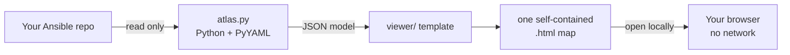

# Ansible Atlas

**An offline, read-only, interactive map of any Ansible repository.**

Point it at a repo and it builds a single HTML page you explore in your browser: playbooks, roles, tasks, inventories, hosts and variables, what a playbook runs and in what order, and where every variable is defined and used.

It's for **exploring only**: nothing is executed, nothing connects to your servers, the page makes no network requests, and there are no export features.

## Quick start

**1. Get the tool**, then work from its folder. That's where `atlas.py` lives, and every command below is run from here:

```bash
git clone https://github.com/Aaronarphaxad/ansible-atlas.git
cd ansible-atlas
```

**2. Install PyYAML once.** It's the only package needed, and it isn't part of Python itself. Use whichever fits your setup:

| Your Python | Install with |
|---|---|
| python.org / Xcode Python (macOS), most Linux | `python3 -m pip install --user pyyaml` (or `pip3 install pyyaml`) |
| Homebrew Python, Debian 12+, Ubuntu 23.04+ (pip says *externally-managed-environment*) | a virtual env: `python3 -m venv ~/.venvs/atlas && ~/.venvs/atlas/bin/pip install pyyaml`, then run with `~/.venvs/atlas/bin/python atlas.py …` |
| Linux system packages | `sudo apt install python3-yaml` or `sudo dnf install python3-pyyaml` |
| Windows | `py -m pip install --user pyyaml` |

Check it with `python3 -c "import yaml"`. If it's missing, `atlas.py` prints the exact install command for the Python you ran it with.

**3. Map a repo.** From the `ansible-atlas` folder, give the path to the **root of the Ansible repo** you want to explore:

```bash
python3 atlas.py </path-to-ansible-repo-dir>
```

For example:

```bash
python3 atlas.py ~/user/my-ansible-repo
```

The map is saved to `~/ansible-atlas-maps/my-ansible-repo.html` and opens in your browser. Your Ansible repo is only read, never changed, and nothing is written inside it.

Try the bundled sample first: `python3 atlas.py example-repo`

### Extras

```bash
# save the map somewhere else (a file, or a folder)
python3 atlas.py ~/user/my-ansible-repo -o ~/my-ansible-map.html
python3 atlas.py ~/user/my-ansible-repo -o ~/Documents/maps/

# don't open the browser
python3 atlas.py ~/user/my-ansible-repo --no-open

# keep it up to date while you edit the repo
python3 atlas.py ~/user/my-ansible-repo -w
```

You can also run it from anywhere by giving the full path to the script, e.g. `python3 ~/tools/ansible-atlas/atlas.py ~/user/my-ansible-repo`.

**Windows:** use `py` instead of `python3`, e.g. `py atlas.py C:\code\my-ansible-repo`. If your Ansible repo lives in **WSL**, run the tool inside WSL and save the map where Windows can open it: `-o /mnt/c/Users/<you>/ansible-atlas-maps/`.

## Options

| Option | Meaning |
|---|---|
| `-o PATH` | Where to save the map: a file, or a folder (saved as `<repo-name>.html` inside). Default `~/ansible-atlas-maps/` |
| `--no-open` | Don't open the map in the browser |
| `-w`, `--watch` | Keep running and rebuild when a file changes. The page reloads itself and keeps your place (**● Live** in the header pauses it) |
| `-l`, `--lint` | Print the checks in the terminal; exit code 2 if there are errors (handy in CI) |
| `--no-redact` | Show values of secret-looking variables (masked by default) |
| `--no-sources` | Don't embed file contents (the file viewer lists names only) |
| `--exclude DIR` | Skip a directory (repeatable). `.git`, venvs and `node_modules` are always skipped |
| `--interval N` | Seconds between change checks in watch mode (default 2) |

The map is the only file written. Re-run whenever the repo changes (about a second), or use `-w`.

## What you get

- **Playbooks, Roles and Inventory maps:** zoomable, collapsible trees from playbooks down to individual tasks, and from inventories down to hosts. Hover a node for a summary, or move around with the arrow keys.
- **Hosts and variables:** a host's groups, the plays that target it, and its merged variables, with the file and line behind each value. **Compare** two hosts side by side with the differences highlighted. Click any variable to see everywhere it's defined and used, including in templates.
- **Run plan:** a numbered list of what a playbook does, in order, with target hosts. **Tags & limit** previews `--tags`, `--skip-tags` and `--limit`, and the matching `ansible-playbook` command is shown with a Copy button.
- **Files & scripts:** read any file in the browser with secrets masked. The **Scripts** filter lists shell scripts and how each is run: on the hosts, on the control node, or by hand.
- **Checks:** lint results (errors, warnings, info) in the Overview and on each affected item.
- **Search** (`/`) across everything, with matches highlighted on the map; light/dark mode (`T`); keyboard shortcuts (`?`).

<details>
<summary><b>Keyboard shortcuts</b></summary>

| Key | Does |
|---|---|
| `/` | Search |
| `1`–`6` | Switch tab |
| `←` `→` `↑` `↓` | Map: parent · first child · previous / next node |
| `Enter` · `Space` | Map: expand / collapse the selected node |
| `N` · `Shift+N` | Map: next / previous search match |
| `F` · double-click empty map | Fit the map to the screen |
| `]` | Show / hide the details panel |
| `Backspace` · `Alt+←` | Back to the previous item |
| `T` | Light / dark mode |
| `Esc` · `?` | Close search and menus · show all shortcuts |

</details>

## How it works

Two parts: `atlas.py` reads your repo, and `viewer/` (plain HTML, CSS and JavaScript) displays it.



1. **Read:** `atlas.py` walks the folder and recognises files by their content: `ansible.cfg`, YAML/INI inventories, `group_vars`/`host_vars`, playbooks, roles, templates, scripts. It builds a model of hosts and merged variables, plays and tasks in execution order, variable usage, and checks. Nothing is executed and no host is contacted.
2. **Package:** the viewer files are joined into one page, and the model and the redacted file contents are embedded in it as JSON, producing one static HTML file.
3. **Display:** plain JavaScript draws the maps as SVG and builds the panels and search in the browser.

**Packages:** the Python standard library plus **PyYAML** (with `SafeLoader`). The viewer uses no frameworks, libraries, fonts or CDNs.

### Built to be secure

- **Offline only:** the page's Content-Security-Policy (`default-src 'none'`) makes the browser block every network request, and allows only the viewer's own script, identified by its SHA-256 hash.
- **No server, no ports, no exports:** you open a local file; nothing can be downloaded, uploaded or sent from it.
- **Stays in the repo:** it only reads files under the folder you give it. Symlinks and includes that point elsewhere on your machine are skipped, so a repo can't pull in your `~/.ssh` or `/etc` files.
- **Private by default:** maps go to `~/ansible-atlas-maps/`, outside any git repo, and are readable only by you (folder `700`, file `600`).
- **Safe parsing:** YAML is loaded with `SafeLoader`, YAML "alias bombs" are rejected, and repo text is always inserted into the page as text, never as HTML.
- **Secrets stay out:** vault content is never decrypted, key files and `.env` files are never embedded, and secret-looking values are masked unless you pass `--no-redact`.
- **Locked-down CI:** read-only permissions and a hash-pinned action, kept up to date by Dependabot.

See [SECURITY.md](SECURITY.md) for the threat model and how to report a vulnerability.

## Keep generated maps private

A map contains real hostnames, IPs and variable values. Don't commit or publish it.

- If you save a map inside a git repo where it isn't ignored, `atlas.py` warns you.
- Generated maps carry a marker, and this repo refuses to commit them: `.gitignore` is an allowlist, `.githooks/pre-commit` blocks marked files and private keys (enable it with `git config core.hooksPath .githooks`), and CI fails if one slips through.

## Limitations

It's static analysis, so anything decided at runtime can't be known offline: Jinja in `hosts:`, templated include paths, dynamic inventories, facts, `--extra-vars`, and whether a `when:` passes. These are labelled where they occur. Roles that aren't in the repo (Galaxy, collections) appear as "external"; install them into the repo (`ansible-galaxy install -r requirements.yml -p roles/`) to map their tasks.

## Development

```bash
git config core.hooksPath .githooks        # enable the commit guard
python3 -m unittest discover -s tests -v   # run the tests
python3 atlas.py example-repo              # try your change
```

The viewer lives in `viewer/`: `index.html` is the page shell, which lists the `css/` and `js/` files to include, in order. The JS files are plain scripts sharing one global scope (no modules or bundler), from `js/core.js` (data and DOM helpers) first to `js/boot.js` (startup) last. `atlas.py` inlines each `/* @include … */` line of `index.html`, so to add a component, create the file and add an include line for it. When you add a file outside `viewer/`, also add it to the allowlist in `.gitignore`.

## License

MIT. See [LICENSE](LICENSE).
