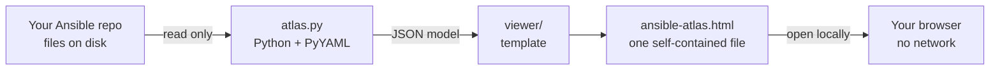

# Ansible Atlas

**An offline, read-only, interactive map of any Ansible repository.**

Point it at a repo and it writes a single HTML file you open in your browser. Use it to explore playbooks, roles, tasks, inventories, groups, hosts and variables; see what a playbook will do, in order, for a given `--tags` / `--limit`; and find where any variable is defined and used.

It's for **exploring only**: nothing is executed, nothing connects to your servers, the page makes no network requests, and there are no export features. See [How it works](#how-it-works) for the architecture and security model.

```bash
python3 atlas.py ~/code/my-ansible-repo -o ~/my-ansible-map.html --open
```

Try it on the bundled sample first: `python3 atlas.py example-repo --open`

## Running it

You need **Python 3.8+** and **PyYAML**. PyYAML is already installed wherever Ansible is, because ansible-core depends on it. No internet access is needed to run the tool.

Download or clone this repo, then point `atlas.py` at the **root** of your Ansible repo so it finds the playbooks, roles and every inventory. Write the map **outside** any git repo (e.g. your home folder) so it can't be committed by accident.

### macOS and Linux

```bash
python3 atlas.py ~/code/my-ansible-repo -o ~/ansible-atlas.html --open
```

If `python3 -c "import yaml"` fails, either use the Python that runs your Ansible (e.g. `~/.local/pipx/venvs/ansible/bin/python atlas.py …`) or install PyYAML:

- Debian/Ubuntu: `sudo apt install python3-yaml`
- RHEL/Fedora/Rocky: `sudo dnf install python3-pyyaml`
- macOS or any OS: `python3 -m pip install --user pyyaml`

### Windows

Install Python from python.org or the Microsoft Store, then in PowerShell:

```powershell
py -m pip install --user pyyaml
py atlas.py C:\code\my-ansible-repo -o $HOME\ansible-atlas.html --open
```

Use `python` instead of `py` if that's how Python is set up on your PC, and put quotes around paths that contain spaces.

If your Ansible repo lives in **WSL** (Ansible's control node doesn't run natively on Windows), run the tool inside WSL and write the map to your Windows home folder so a Windows browser can open it:

```bash
python3 atlas.py ~/code/my-ansible-repo -o /mnt/c/Users/<you>/ansible-atlas.html
```

Then open `C:\Users\<you>\ansible-atlas.html` in your browser (`--open` may not work from inside WSL).

### Try it first

Run it on the bundled sample repo (`py` on Windows):

```bash
python3 atlas.py example-repo -o ~/atlas-example.html --open
```

## Usage

```
python3 atlas.py <repo> [-o FILE] [--open] [--watch] [--interval N] [--lint]
                        [--no-redact] [--no-sources] [--exclude DIR]
```

| Option | Meaning |
|---|---|
| `-o FILE` | Output file (default `ansible-atlas.html` in the current folder) |
| `--open` | Open the result in your default browser |
| `--watch` | Keep running and rebuild when any file changes. The open page reloads itself and keeps your place (toggle **● Live** in the header) |
| `--interval N` | Seconds between change checks in watch mode (default 2) |
| `--lint` | Print the checks in the terminal. Exits with code 2 if there are error-level findings, so you can use it in CI |
| `--no-redact` | Show values of secret-looking variables (masked by default) |
| `--no-sources` | Don't embed file contents (the file viewer then lists names only) |
| `--exclude DIR` | Skip a directory name (repeatable). `.git`, venvs, `node_modules` and `ansible_collections` are skipped by default |

The map is the only file written. Re-run it whenever the repo changes (it takes about a second), or use `--watch`.

## What you get

- **Playbooks map**: playbooks → imported playbooks → plays → pre-tasks / roles / tasks / post-tasks / handlers → role dependencies → tasks, blocks and includes. Zoom, pan, and expand or collapse any node. Maps open collapsed to the entry points; hover a node for a quick summary, or move around with the arrow keys.
- **Roles map**: each role with its dependencies, tasks, handlers, defaults, vars and templates, and which plays use it.
- **Inventory map**: inventories → groups → child groups → hosts. A host shows its groups, the plays that target it, and its **merged variables**: which file and line set each value, and what it overrides. **Compare** two hosts (e.g. a production host and its staging twin) to see their variables, groups and plays side by side with the differences highlighted.
- **Variables**: click any variable name to see **every place it's defined** (inventory, group_vars, host_vars, role defaults/vars, play vars, `set_fact`, `register`) and **everywhere it's used** (task arguments, `when:`, loops, other variables, templates).
- **Templates**: open any `.j2` file with line numbers, highlighted Jinja and clickable variables, plus the tasks that render it.
- **Run plan**: a numbered, step-by-step list of what a playbook does, with target hosts for a chosen inventory. Under **Tags & limit** you can preview `--tags`, `--skip-tags` and `--limit`. It follows Ansible's tag inheritance and the special tags `always`, `never`, `tagged` and `untagged`, and gives you the matching `ansible-playbook` command to copy.
- **Files & scripts**: browse every file in the repo as a folder tree and read it in the browser, with line numbers and masked secrets. Clicking any `file:line` reference anywhere opens the file at that line. The **Scripts** filter lists shell scripts (`.sh`, `.bash`, `.ps1`, anything with a `#!` line, and `.py`/`.pl`/`.rb` under `scripts/`, `bin/` or `files/`). For each one it shows how it's run: uploaded to hosts by `script:`, run on the control node, copied, scheduled with cron, or not referenced by any task (run by hand).
- **Checks** (lint): errors such as missing files, unknown handlers and YAML errors; warnings such as undefined variables, plain-text secrets, shell commands where a module exists, plays with no hosts and external roles; and info-level items such as unused variables, roles and handlers, missing `changed_when` or `mode:`, `state: latest` and `ignore_errors`. They appear in the Overview and on the affected item, or in the terminal with `--lint`.
- **Search** (press `/`): finds variables, hosts, groups, tasks, roles, plays, templates, scripts (including their contents) and files. Narrow results with a prefix such as `var:`, `host:`, `group:`, `task:`, `role:`, `template:` or `file:`. Matching map nodes are tinted; a bar on the map counts matches hidden in collapsed branches, and `N` / `Shift+N` step through them.
- **Overview**: counts, checks, inventories, entry playbooks, and parser warnings. `ansible.cfg`, requirements and vault files are folded away until you need them.
- **Light and dark mode** (dark by default): press `T` or use the ☀/☾ button.

Less-used controls are tucked away: the `⋯` menu holds expand/collapse and level options, **Legend** toggles the colour key, and secondary sections in the details panel start collapsed. Your place (tab, selection, zoom, filters) is kept when you refresh the page.

### Keyboard shortcuts

| Key | Does |
|---|---|
| `/` | Search |
| `1`–`6` | Switch tab |
| `←` `→` `↑` `↓` | Map: parent · first child · previous / next node in the column |
| `Enter` · `Space` | Map: expand / collapse the selected node |
| `N` · `Shift+N` | Map: next / previous search match |
| `F` · double-click empty map | Fit the map to the screen |
| `]` | Show / hide the details panel (its width is remembered) |
| `Backspace` · `Alt+←` | Back to the previous item |
| `T` | Light / dark mode |
| `Esc` | Close search and menus |
| `?` | Show all shortcuts |

There are deliberately **no export features**: the page can't download, save or send anything. It's for exploring the repo, and the data stays in the one HTML file on your machine.

## What it reads

It doesn't assume a fixed layout. It walks the whole folder and identifies files by their content:

- `ansible.cfg`, including `inventory` and `roles_path`
- YAML and INI inventories, including `[group:vars]`, `[group:children]` and host ranges like `web[01:03]`. Directories under `inventory/` or `inventories/` are merged the way Ansible merges them.
- `group_vars/` and `host_vars/`, next to inventories and next to playbooks, in file or directory form
- Playbooks: any YAML list of plays or `import_playbook`s, anywhere in the repo
- Roles: `meta` dependencies, `defaults`, `vars`, `tasks`, `handlers`, `templates` and `files`
- Templates (`templates/` folders and `*.j2` files) and `requirements.yml`
- Vault: encrypted files and inline `!vault` values are detected, but **never decrypted**

## How it works

Ansible Atlas has two parts: a Python script that reads your repo (`atlas.py`) and an HTML/CSS/JavaScript template that displays the result (`viewer/`). Generating a map is a one-way, offline step:



**1. Read (`atlas.py`).** The script walks the folder and identifies files by their content, not their location: `ansible.cfg`, YAML/INI inventories, `group_vars`/`host_vars`, playbooks, roles, task files, templates, scripts and `requirements.yml`. It builds an in-memory model of the repo:

- **inventories:** groups, hosts and their parent/child links, plus each host's merged variables in Ansible's precedence order
- **playbooks:** plays, roles, tasks, blocks, includes and handlers, each with its source file and line
- **run plans:** every playbook flattened into execution order, with inherited tags and host patterns resolved against each inventory
- **indexes:** where each variable is defined and used (found by parsing Jinja expressions), which tasks render each template and run each script, and the lint checks

Nothing is executed: no Ansible code is imported, no templates or lookups are evaluated, and no host is contacted.

**2. Package.** `atlas.py` joins the viewer's components (`viewer/index.html` plus the files it includes from `viewer/css/` and `viewer/js/`) into one page, then embeds the model as JSON, together with the redacted file contents for the file viewer. The result is a **single static HTML file** with no external dependencies, and it's the only file the tool writes.

**3. Display (`viewer/`).** When the page opens, plain JavaScript reads the embedded JSON and builds everything in the browser:

- the maps are drawn as **SVG**, with a simple tree layout, collapsible nodes, and pan and zoom
- the run plan, file viewer, checks and details panel are ordinary HTML built from the model
- search is an in-memory index built when the page loads

**Watch mode** repeats steps 1–2 whenever a file's timestamp or size changes, and replaces the output file atomically. The page reloads itself on a timer and restores your place from the browser's `sessionStorage`.

### Packages

| Part | Uses |
|---|---|
| `atlas.py` | Python standard library: `os`, `pathlib`, `re`, `json`, `configparser` (for `ansible.cfg`), `shlex`, `fnmatch`, `argparse`, `datetime`, `webbrowser` (only for `--open`), `subprocess` (only to ask your local `git` whether the output file is ignored) |
| | **PyYAML** with a `SafeLoader`, the only third-party package. It's already installed with Ansible. |
| `viewer/` | Plain HTML, CSS and JavaScript: no frameworks, libraries, fonts or CDNs |
| Tests / CI | `unittest` (standard library); GitHub Actions runs the tests and checks that no generated output is committed |

### Built to be secure

- **Offline only.** The generated page carries a Content-Security-Policy of `default-src 'none'`. The browser itself blocks every network request: no scripts, styles, fonts, images or fetches from anywhere. Everything the page needs is inside the file.
- **Only its own code runs.** The policy allows exactly one script, identified by its SHA-256 hash, which `atlas.py` computes at build time. Even if text from a repo somehow ended up in the page as markup, the browser would refuse to run it.
- **Exploration only.** There are no export, download or upload features. The only way data leaves the page is if you copy text by hand.
- **No server, no ports.** You open the file directly (`file://`). Watch mode rewrites the file; it doesn't serve it.
- **Read-only, and stays in the repo.** The script only reads files under the folder you give it (plus any `roles_path` from its `ansible.cfg`). Symlinks, `include_vars`, `import_tasks` and so on that point elsewhere on your machine are skipped with a warning. That way a repo can't pull your `~/.ssh` or `/etc` files into a map you then share.
- **Safe parsing.** YAML is loaded with `SafeLoader`, which can't construct Python objects. YAML "alias bombs" (a few lines that expand to billions of values) are rejected, so a hostile repo can't hang the scan. Untrusted text is always inserted into the page as text, never as HTML.
- **Private output.** The map is written via a fresh temporary file (never through an existing symlink) and is readable only by you (`0600`). It shows the repo path relative to your home folder (`~/…`), so it doesn't reveal your username.
- **Secrets stay out.** Vault content is never decrypted. Key files and `.env` files are never embedded. Secret-looking values are masked in tables and in the file viewer unless you pass `--no-redact`.
- **Hard to leak.** Generated files are marked. The `.gitignore` allowlist, the pre-commit hook, CI, and a warning from `atlas.py` all stop them from being committed (see [Keep generated maps private](#keep-generated-maps-private)).
- **Small and reviewable.** One Python script and a handful of small, commented viewer files; one well-known dependency; no build tools (`atlas.py` just joins the viewer files).
- **Locked-down CI.** The workflow has read-only permissions, pins its one action to a commit hash rather than a movable tag, and doesn't keep the GitHub token after checkout. Dependabot proposes updates to the pinned action.

See [SECURITY.md](SECURITY.md) for the threat model and how to report a vulnerability.

## Keep generated maps private

A generated map contains real hostnames, IPs and variable values from the repo it was run on. Don't commit it or publish it.

- `atlas.py` prints a **warning** if you write the map inside a git repo where it isn't ignored, such as your Ansible repo. Writing it outside any repo (e.g. `-o ~/ansible-atlas.html`) avoids this.
- Every generated file carries a marker. This repo refuses to commit marked files in three ways:
  - `.gitignore` is an **allowlist**: everything is ignored unless explicitly listed, so stray maps, `.env` files, keys or copied inventories never get staged.
  - `.githooks/pre-commit` blocks commits containing a generated map (even if renamed or force-added) or a private key. Enable it once per clone with `git config core.hooksPath .githooks`.
  - CI fails if a marked file or private key ever reaches the repository.

## Limitations

- It's static analysis. Things decided at runtime can't be known offline: Jinja in `hosts:`, templated include paths, dynamic inventory plugins/scripts, facts, `--extra-vars`, and whether a `when:` passes. These are labelled where they occur.
- Host variables follow Ansible's inventory precedence. Play, role and extra vars can still override them at runtime.
- Variable usage is found by parsing Jinja expressions, so a variable built dynamically (e.g. `vars['app_' + name]`) won't be linked.
- Roles from Galaxy or collections that aren't in the repo appear as "external". Install them into the repo (`ansible-galaxy install -r requirements.yml -p roles/`) to map their tasks.
- Plain-English task summaries cover about 100 common modules. Other modules show their name and arguments.

## Development

```bash
git config core.hooksPath .githooks        # enable the commit guard
python3 -m unittest discover -s tests -v   # run the tests
python3 atlas.py example-repo --open       # try your change
```

`atlas.py` builds a JSON model of the repo and injects it into the viewer template. The viewer lives in `viewer/`:

| File | What it is |
|---|---|
| `index.html` | Page shell. Lists the CSS and JS files to include, in order |
| `css/theme.css` · `layout.css` · `map.css` · `details.css` · `pages.css` | Colours and base styles · page layout and overlays · map · details panel · full-page tabs |
| `js/core.js` | Embedded data (`D`, `ENT`), DOM helpers, entity types and formatting |
| `js/app.js` | Shared UI state and tab switching |
| `js/map-model.js` · `map-view.js` | Map trees and layout · drawing, pan/zoom, selection |
| `js/map-keyboard.js` · `map-search.js` · `map-hover.js` | Arrow-key navigation · search match bar · hover preview |
| `js/details.js` · `details-renderers.js` · `code-view.js` | Details panel: selection and building blocks · one renderer per entity type · file listing |
| `js/compare.js` | Compare two hosts |
| `js/checks.js` · `run-plan.js` · `files.js` · `overview.js` | Lint findings · Run plan tab · Files tab · Overview tab |
| `js/search.js` · `theme.js` · `persistence.js` · `shell.js` · `boot.js` | Search · light/dark · remembering your place · details panel and shortcuts overlay · startup |

The JS files are plain scripts that share one global scope (no modules or bundler). `atlas.py` inlines each `/* @include … */` line of `index.html` in order, so `core.js` comes first and `boot.js` last. To add a component, create the file and add an include line for it. When you add a new file to the project outside `viewer/`, also add it to the allowlist in `.gitignore`.

## License

MIT. See [LICENSE](LICENSE).
